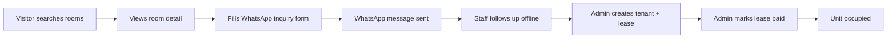
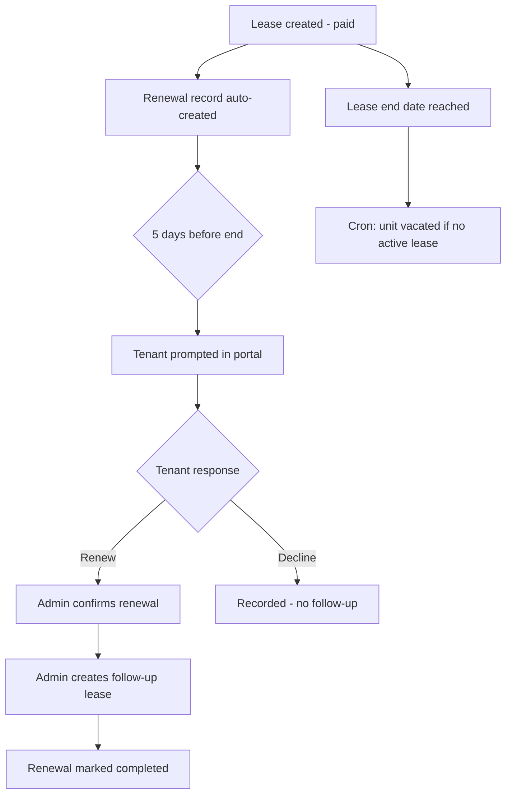

# Cherry Sky Living — System Proposal

**Document type:** Project proposal and requirements specification  
**Platform:** Cherry Sky Living (Cherry Sky Kost)  
**Location:** Medan, Indonesia  
**Version:** 1.0  
**Date:** June 2026

---

## Table of contents

1. [Executive summary](#1-executive-summary)
2. [Background and problem statement](#2-background-and-problem-statement)
3. [Project objectives](#3-project-objectives)
4. [Proposed solution](#4-proposed-solution)
5. [Scope of work](#5-scope-of-work)
6. [Functional requirements](#6-functional-requirements)
7. [Non-functional requirements](#7-non-functional-requirements)
8. [Technical architecture](#8-technical-architecture)
9. [Data model](#9-data-model)
10. [User roles and access control](#10-user-roles-and-access-control)
11. [Key business workflows](#11-key-business-workflows)
12. [Deliverables](#12-deliverables)
13. [Implementation phases](#13-implementation-phases)
14. [Assumptions and constraints](#14-assumptions-and-constraints)
15. [Success criteria](#15-success-criteria)
16. [Out of scope and future enhancements](#16-out-of-scope-and-future-enhancements)
17. [Related documentation](#17-related-documentation)

---

## 1. Executive summary

Cherry Sky Living operates kost (boarding house) properties in Medan. Today, attracting new residents, managing room inventory, tracking leases, handling renewals, and recording income/expenses rely heavily on manual processes — spreadsheets, WhatsApp messages, and ad-hoc record keeping.

This proposal defines a **unified digital platform** consisting of:

- A **public website** for property discovery, room search, and inquiry capture
- A **tenant portal** for lease visibility, renewal responses, and account management
- An **admin suite** for property staff to manage inventory, leases, tenants, renewals, and bookkeeping
- A **REST API backend** with authentication, file storage, scheduled jobs, and role-based access

The system is bilingual (**English** and **Indonesian**), mobile-friendly, and designed around the real operational model of short-to-medium-term kost rentals with flexible pricing packages (7, 12, and 30-day durations).

---

## 2. Background and problem statement

### Current challenges

| Challenge | Impact |
|---|---|
| No centralized room catalogue | Prospective tenants cannot easily compare availability and pricing across properties |
| Manual inquiry handling | Booking requests via phone/WhatsApp lack structured data (name, duration, check-in date) |
| Fragmented lease records | Difficult to track who occupies which room, when leases end, and payment status |
| Renewal coordination | Last-minute renewals create vacancy gaps and administrative overhead |
| No tenant self-service | Tenants must contact staff for basic lease information |
| Informal bookkeeping | Income and expenses are hard to reconcile per property and period |
| Image and document handling | Payment proofs and property photos are scattered across devices |

### Business need

Cherry Sky Living requires a single platform that:

1. Markets available rooms professionally online
2. Converts visitor interest into structured inquiries (WhatsApp-first, aligned with local practice)
3. Gives staff full control over properties, units, pricing, and leases
4. Automates occupancy updates and renewal deadlines where possible
5. Provides tenants a secure portal for their rental relationship
6. Supports basic financial record-keeping with receipt attachments

---

## 3. Project objectives

| # | Objective | Measurable outcome |
|---|---|---|
| O1 | Increase discoverability | Public search and property pages live with real-time vacancy |
| O2 | Streamline inquiries | WhatsApp inquiry form captures name, phone, duration, and check-in date |
| O3 | Centralize operations | All properties, unit types, units, and pricing managed in admin suite |
| O4 | Enforce lease integrity | System prevents overlapping leases on units and tenants |
| O5 | Automate renewals | 5-day renewal window with tenant response and admin confirmation flow |
| O6 | Enable tenant self-service | Tenants view leases, payment proof, and respond to renewals online |
| O7 | Support bookkeeping | Income/expense ledger with categories, filters, and summary totals |
| O8 | Secure multi-role access | Separate portals for tenants, admins, and superadmins |

---

## 4. Proposed solution

### Solution overview

```
┌─────────────────────────────────────────────────────────────────┐
│                     Cherry Sky Living Platform                   │
├─────────────────┬─────────────────────┬─────────────────────────┤
│  Public Website │   Tenant Portal     │      Admin Suite        │
│  (no login)     │   (/tenant)         │      (/admin)           │
├─────────────────┴─────────────────────┴─────────────────────────┤
│              Next.js Frontend (Vercel / Node.js)                 │
│              Proxy: /api/backend → API_URL                       │
├─────────────────────────────────────────────────────────────────┤
│              REST API — Elysia on Bun (Railway / DO)             │
│              Auth: Better Auth  │  DB: Prisma  │  Cron jobs     │
├─────────────────────────────────────────────────────────────────┤
│              PostgreSQL          │    DigitalOcean Spaces (S3)   │
└─────────────────────────────────────────────────────────────────┘
```

### Three user-facing applications

| Application | Users | Primary value |
|---|---|---|
| **Public website** | Visitors, prospective tenants | Brand presence, search, property/room detail, WhatsApp inquiry |
| **Tenant portal** | Registered tenants | Lease visibility, renewal decisions, profile management |
| **Admin suite** | Property staff | Full operational control — inventory, leases, tenants, finance |

All three share one backend API and one authentication system with role-based routing.

---

## 5. Scope of work

### In scope

#### Public website
- Homepage with featured properties and facilities
- Room search with filters (text, property, city, price, duration, vacancy, date range)
- Property detail and room type detail pages with image galleries
- WhatsApp inquiry dialog (name, phone, duration, check-in, deposit note)
- Contact, About, Terms & Conditions, and Privacy Policy pages
- English and Indonesian localization

#### Tenant portal
- Email/password sign-in (Better Auth session)
- Lease list and lease detail (including payment proof images)
- Lease renewal response (renew, decline, cancel)
- Lease renewals tracking page with status filters
- Profile update (name) and password change

#### Admin suite
- Dashboard with portfolio stats and recent activity
- CRUD for properties, unit types, units, and pricing packages
- Unit map/table views and vacant-room search by date range
- Lease management with overlap validation and downpayment proof upload
- Lease renewal management (confirm, create follow-up lease)
- Tenant account management (create, activate/deactivate, reset password)
- Staff account management (superadmin only)
- Bookkeeping (income/expense entries with categories, date filters, summary)
- Image uploads for properties, unit types, leases, and ledger entries

#### Backend API
- REST API with consistent `{ data }` response envelope
- Better Auth (sign-up, sign-in, sign-out, session)
- Admin, tenant, and public route groups
- DigitalOcean Spaces integration (upload, resize, WebP conversion)
- Scheduled jobs: lease expiry and renewal auto-confirmation
- Rate limiting (stricter on upload routes)

### Explicit exclusions (v1)

- Online payment gateway integration (leases are marked paid manually by admin)
- Public self-registration for tenants (accounts created by admin)
- Maintenance request ticketing
- Push notifications / email automation for renewals
- Native mobile apps (responsive web only)
- Multi-currency support (IDR only)

---

## 6. Functional requirements

Requirements are grouped by module. IDs use the format `FR-<module>-<number>` for traceability.

### 6.1 Authentication and authorization

| ID | Requirement | Priority |
|---|---|---|
| FR-AUTH-01 | System shall support email/password sign-in via Better Auth at `/auth` | Must |
| FR-AUTH-02 | System shall issue session cookies (`better-auth.session_token`) on successful sign-in | Must |
| FR-AUTH-03 | System shall enforce role-based access: `tenant`, `admin`, `superadmin` | Must |
| FR-AUTH-04 | Admin routes shall return `403` for non-admin roles | Must |
| FR-AUTH-05 | Staff management routes shall be restricted to `superadmin` | Must |
| FR-AUTH-06 | Deactivated users (`isActive: false`) shall not sign in; active sessions revoked on deactivation | Must |
| FR-AUTH-07 | Admin shall reset tenant/staff passwords with temporary 8-character password | Must |
| FR-AUTH-08 | Tenant shall change password via `PUT /profile/password` with current password verification | Must |
| FR-AUTH-09 | Tenant and admin login pages shall reject wrong-role sign-in with clear error | Must |

### 6.2 Public website

| ID | Requirement | Priority |
|---|---|---|
| FR-PUB-01 | Homepage shall display featured properties and facility highlights | Must |
| FR-PUB-02 | Search page shall query `GET /public/search` with filters: `q`, `city`, `propertyId`, `unitTypeId`, `status`, `startDate`/`endDate`, `minPrice`, `maxPrice`, `durationDays` | Must |
| FR-PUB-03 | Search shall default without `durationDays` until user explicitly selects a duration | Must |
| FR-PUB-04 | Property detail shall load from `GET /public/properties/:id` with unit types, units, pricing, and images | Must |
| FR-PUB-05 | Room detail shall show gallery, facilities, pricing packages, and availability count | Must |
| FR-PUB-06 | WhatsApp inquiry shall collect name, phone, duration, check-in date and open pre-filled WhatsApp message | Must |
| FR-PUB-07 | Inquiry message shall note Rp 300.000 deposit requirement | Must |
| FR-PUB-08 | Contact page shall provide address, phone, email, and inquiry form | Must |
| FR-PUB-09 | About, Terms, and Privacy pages shall be available in EN and ID | Must |
| FR-PUB-10 | Public routes shall require no authentication | Must |

### 6.3 Property inventory (admin)

| ID | Requirement | Priority |
|---|---|---|
| FR-INV-01 | Admin shall create/read/update/delete properties (name, address, city) | Must |
| FR-INV-02 | Admin shall create/read/update/delete unit types per property (name, description, size) | Must |
| FR-INV-03 | Unit type names shall be unique within a property | Must |
| FR-INV-04 | Admin shall create/read/update/delete units (name, unit type, max occupancy, status) | Must |
| FR-INV-05 | Unit names shall be unique within a property | Must |
| FR-INV-06 | New units shall default to `vacant` status | Must |
| FR-INV-07 | Admin shall not delete unit types with assigned units (`409`) | Must |
| FR-INV-08 | Admin shall not delete occupied units (`409`) | Must |
| FR-INV-09 | Admin shall upload images for properties and unit types (post-save) | Must |
| FR-INV-10 | Admin shall view units in map or table view with occupancy indicators | Must |
| FR-INV-11 | Admin shall search vacant units for a date range via `GET /admin/units/vacant` | Must |
| FR-INV-12 | Deleting a property shall cascade-delete associated units | Must |

### 6.4 Pricing (admin)

| ID | Requirement | Priority |
|---|---|---|
| FR-PRC-01 | Admin shall define pricing packages per unit type: `durationDays` + `price` (IDR) | Must |
| FR-PRC-02 | Only one pricing row per duration per unit type (`409` on duplicate) | Must |
| FR-PRC-03 | Admin shall not delete pricing referenced by leases (`409`) | Must |
| FR-PRC-04 | Pricing shall appear on public property and search results | Must |

### 6.5 Leases (admin)

| ID | Requirement | Priority |
|---|---|---|
| FR-LS-01 | Admin shall create leases linking unit, tenant, start date, and pricing package | Must |
| FR-LS-02 | Lease `endDate` shall be computed as `startDate + unitPricing.durationDays` | Must |
| FR-LS-03 | Creating a lease shall auto-create a 1:1 `leaseRenewal` record | Must |
| FR-LS-04 | Renewal deadline (`leaseEndDate`) shall be lease `endDate` minus 5 days | Must |
| FR-LS-05 | Creating a lease shall not auto-occupy the unit | Must |
| FR-LS-06 | Setting lease status to `paid` shall set unit to `occupied` | Must |
| FR-LS-07 | Deleting a lease shall set unit to `vacant` and cascade-delete renewal | Must |
| FR-LS-08 | System shall reject overlapping leases on the same unit (`409`) | Must |
| FR-LS-09 | System shall reject overlapping leases for the same tenant across any unit (`409`) | Must |
| FR-LS-10 | Back-to-back leases (new start = prior end) shall be allowed | Must |
| FR-LS-11 | Admin shall update lease start date, pricing, and status (`unpaid`, `waiting_for_review`, `paid`) | Must |
| FR-LS-12 | Admin shall upload optional downpayment proof on lease create (multipart) | Must |
| FR-LS-13 | Admin shall create renewal follow-up lease with `leaseRenewalId` to mark renewal completed | Must |
| FR-LS-14 | Parent lease shall be excluded from overlap checks when creating renewal follow-up | Must |

### 6.6 Lease renewals

| ID | Requirement | Priority |
|---|---|---|
| FR-RN-01 | Tenant shall request renewal via `PUT /leases/:id/renewal` (`isRenewLease: true`) on paid leases only | Must |
| FR-RN-02 | Tenant shall decline/cancel renewal (`isRenewLease: false`); system sets `isConfirmed: true` | Must |
| FR-RN-03 | Admin shall confirm renewal requests via `PUT /admin/leases/:id/renewal` | Must |
| FR-RN-04 | Cron job shall auto-set `isConfirmed: true` when deadline passes and still `false` | Must |
| FR-RN-05 | Tenant portal shall show renewal prompt within 5-day window before lease end | Must |
| FR-RN-06 | Admin lease renewals page shall filter by request status and support confirm + create follow-up lease | Must |
| FR-RN-07 | Tenant lease renewals page shall show status: action needed, requested, confirmed, completed, declined | Must |

### 6.7 Tenants (admin)

| ID | Requirement | Priority |
|---|---|---|
| FR-TNT-01 | Admin shall create tenant accounts (name, email, password) | Must |
| FR-TNT-02 | Admin shall search tenants by name or email | Must |
| FR-TNT-03 | Admin shall activate/deactivate tenant accounts | Must |
| FR-TNT-04 | Admin shall view tenant detail with full lease history | Must |
| FR-TNT-05 | Admin shall reset tenant password and receive temporary password | Must |
| FR-TNT-06 | Admin shall quick-create tenant from lease form | Should |

### 6.8 Staff (superadmin)

| ID | Requirement | Priority |
|---|---|---|
| FR-STF-01 | Superadmin shall create staff accounts with role `admin` or `superadmin` | Must |
| FR-STF-02 | Superadmin shall not deactivate self or last remaining superadmin | Must |
| FR-STF-03 | Superadmin shall not demote last remaining superadmin | Must |
| FR-STF-04 | Superadmin shall reset staff passwords | Must |

### 6.9 Bookkeeping (admin)

| ID | Requirement | Priority |
|---|---|---|
| FR-BK-01 | Admin shall record income and expense ledger entries | Must |
| FR-BK-02 | Entries shall support categories per type (rent, utilities, maintenance, etc.) | Must |
| FR-BK-03 | Admin shall filter entries by property, type, and date range (`startDate`, `endDate`) | Must |
| FR-BK-04 | List response shall include `summary` with income, expense, and net totals | Must |
| FR-BK-05 | Admin shall attach optional receipt/invoice image on entry create | Must |
| FR-BK-06 | Entries shall optionally link to a property | Must |

### 6.10 Attachments and file storage

| ID | Requirement | Priority |
|---|---|---|
| FR-ATT-01 | System shall accept JPEG, PNG, WebP, GIF up to 5 MB | Must |
| FR-ATT-02 | Images shall be resized (max 1920px) and converted to WebP before storage | Must |
| FR-ATT-03 | Files shall be stored in DigitalOcean Spaces with public-read ACL | Must |
| FR-ATT-04 | Admin shall delete attachments (property, unit type, lease downpayment, ledger) | Must |
| FR-ATT-05 | Storage health check endpoint shall verify upload/delete capability | Should |

### 6.11 Tenant portal

| ID | Requirement | Priority |
|---|---|---|
| FR-TPL-01 | Tenant shall view all own leases with unit, property, pricing, and renewal info | Must |
| FR-TPL-02 | Tenant shall view lease detail including downpayment proof images | Must |
| FR-TPL-03 | Tenant shall update display name on profile | Must |
| FR-TPL-04 | Tenant shall not change email via profile (admin-managed) | Must |
| FR-TPL-05 | Tenant shall access lease renewals page with filters and status hints | Must |

### 6.12 Background jobs

| ID | Requirement | Priority |
|---|---|---|
| FR-CRON-01 | `expire-leases` shall run daily at 00:00:00 and vacate units when paid lease ends | Must |
| FR-CRON-02 | `confirm-lease-renewals` shall run daily at 00:00:00 and auto-confirm pending renewals past deadline | Must |
| FR-CRON-03 | Cron jobs shall only run while backend process is active | Must |

### 6.13 Dashboard (admin)

| ID | Requirement | Priority |
|---|---|---|
| FR-DASH-01 | Dashboard shall show property count, unit count, occupancy, active leases | Must |
| FR-DASH-02 | Dashboard shall highlight leases expiring within 5 days | Must |
| FR-DASH-03 | Dashboard shall show monthly revenue from paid leases | Should |
| FR-DASH-04 | Dashboard shall provide quick-action links to common tasks | Should |

---

## 7. Non-functional requirements

| ID | Category | Requirement |
|---|---|---|
| NFR-01 | Performance | Public search and property pages shall load within acceptable time on 4G mobile connections |
| NFR-02 | Security | All authenticated routes require valid session; admin routes require admin role |
| NFR-03 | Security | Passwords hashed via Better Auth; temporary passwords invalidated on session revoke |
| NFR-04 | Security | Rate limiting enabled by default; upload routes limited to 20 req/min |
| NFR-05 | Availability | Frontend deployed on Vercel; backend on Railway or equivalent with process uptime for cron |
| NFR-06 | i18n | All user-facing strings available in English and Indonesian |
| NFR-07 | Responsive | UI usable on mobile, tablet, and desktop viewports |
| NFR-08 | API consistency | Success responses use `{ data }`; errors use `{ success: false, error: { code, message } }` |
| NFR-09 | Audit trail | Records track `createdById`, `updatedById`, `createdAt`, `updatedAt` |
| NFR-10 | Data integrity | Prisma schema enforces unique constraints (unit name per property, pricing duration per type, etc.) |
| NFR-11 | Cookie security | Session cookies proxied via `/api/backend` for first-party cookie scope |
| NFR-12 | Maintainability | TypeScript throughout; Biome for lint/format; modular API client per domain |

---

## 8. Technical architecture

### 8.1 Frontend

| Component | Technology |
|---|---|
| Framework | Next.js 16 (App Router) |
| UI library | React 19 |
| Language | TypeScript |
| Styling | Tailwind CSS 4, custom design tokens |
| State / data | TanStack Query, TanStack Form, TanStack Table |
| i18n | next-intl (`/en`, `/id` locale prefix) |
| Validation | Zod |
| Auth client | Better Auth (session via proxy) |

**Deployment:** Vercel (or Node.js host)  
**Env:** `API_URL` — backend base URL for `/api/backend` proxy

### 8.2 Backend

| Component | Technology |
|---|---|
| Runtime | Bun |
| Framework | Elysia |
| ORM | Prisma |
| Database | PostgreSQL |
| Auth | Better Auth (`/auth`) |
| File storage | DigitalOcean Spaces (S3-compatible) |
| Scheduling | `@elysia/cron` |
| Image processing | Sharp (resize, WebP conversion) |

**Deployment:** Railway (production example: `cherry-sky-kost-backend-production.up.railway.app`)  
**Local dev:** `http://localhost:8000`

### 8.3 Integration pattern

```
Browser → https://cherryskyliving.com/api/backend/*
       → Next.js proxy route
       → API_URL (backend)
       ← JSON + Set-Cookie (session)
```

Public data endpoints (`/public/*`) need no session. Tenant and admin endpoints require authenticated cookies forwarded by the proxy.

---

## 9. Data model

### Entity relationship (simplified)

```
User (tenant | admin | superadmin)
  └── Lease ── Unit ── UnitType ── Property
        │         │
        │         └── UnitPricing (per duration)
        ├── LeaseRenewal (1:1)
        ├── LeaseDownpaymentAttachment[]
        └── unitPricing

LedgerEntry ── Property (optional)
  └── LedgerEntryAttachment[]

Property ── PropertyAttachment[]
UnitType ── UnitTypeAttachment[]
```

### Core entities

| Entity | Purpose |
|---|---|
| `Property` | Physical kost building |
| `UnitType` | Room category within a property |
| `UnitPricing` | Price for a given rental duration |
| `Unit` | Individual rentable room |
| `Lease` | Rental agreement |
| `LeaseRenewal` | Renewal tracking (1:1 with lease) |
| `User` | Tenant or staff account |
| `LedgerEntry` | Income or expense record |
| `*Attachment` | Image metadata linked to property, unit type, lease, or ledger entry |

Full field reference: [README-Backend.md](../README-Backend.md#data-models-reference).

---

## 10. User roles and access control

| Role | Portal | Capabilities |
|---|---|---|
| **Visitor** | Public website | Browse, search, inquire — no account |
| **Tenant** | `/tenant` | Own leases, renewals, profile |
| **Admin** | `/admin` | Full operations except staff management |
| **Superadmin** | `/admin` | Admin capabilities + staff CRUD |

### Route access matrix

| Route prefix | Visitor | Tenant | Admin | Superadmin |
|---|---|---|---|---|
| `/public/*` | ✓ | ✓ | ✓ | ✓ |
| `/leases`, `/profile` | — | ✓ (own) | — | — |
| `/admin/*` (except staff) | — | — | ✓ | ✓ |
| `/admin/staff` | — | — | — | ✓ |

---

## 11. Key business workflows

### 11.1 Visitor inquiry to lease



### 11.2 Lease renewal lifecycle



### 11.3 Bookkeeping cycle

1. Admin records income (e.g. rent received) or expense (e.g. utilities bill)
2. Optional receipt image attached
3. Filter by property and month for reconciliation
4. Review summary totals (income, expense, net)

---

## 12. Deliverables

| # | Deliverable | Description |
|---|---|---|
| D1 | Public website | Deployed Next.js app with all public pages and search |
| D2 | Tenant portal | Authenticated tenant views for leases, renewals, profile |
| D3 | Admin suite | Full CRUD and operational dashboards |
| D4 | REST API | Documented Elysia backend with all route groups |
| D5 | Database schema | Prisma schema with seed data (SKYKOST, CHERRY KOST samples) |
| D6 | File storage integration | DigitalOcean Spaces upload pipeline |
| D7 | Cron jobs | Lease expiry and renewal auto-confirmation |
| D8 | Documentation | README, API reference, user guide, this proposal |
| D9 | Localization | `en.json` and `id.json` locale files |

---

## 13. Implementation phases

Phases reflect logical build order aligned with dependencies.

### Phase 1 — Foundation
- Backend project setup (Elysia, Prisma, PostgreSQL)
- Authentication (Better Auth, roles)
- Core data models: Property, UnitType, Unit, UnitPricing
- Admin CRUD for inventory
- DigitalOcean Spaces integration

### Phase 2 — Public presence
- Public API (`/public/properties`, `/public/search`)
- Frontend homepage, search, property/room detail
- WhatsApp inquiry flow
- Contact, About, Terms, Privacy pages
- EN/ID localization

### Phase 3 — Lease operations
- Lease CRUD with overlap validation
- Lease renewal model and cron jobs
- Tenant portal (leases, renewals, profile)
- Admin lease and renewal management
- Downpayment proof uploads

### Phase 4 — Operations and finance
- Admin dashboard with stats
- Tenant and staff user management
- Bookkeeping with categories, filters, and summaries
- Unit map view and vacant-room search
- Password reset flows

### Phase 5 — Hardening and launch
- Rate limiting and error handling review
- Storage health check
- Production deployment (Vercel + Railway)
- Seed data and staff onboarding
- User guide and training

---

## 14. Assumptions and constraints

### Assumptions

- Properties operate primarily in Medan with IDR pricing
- WhatsApp remains the primary channel for booking follow-up (no in-app chat required)
- Tenants receive credentials from admin rather than self-registering
- Staff have reliable internet access for admin suite
- Backend process runs continuously in production for cron jobs
- DigitalOcean Spaces credentials are available for image storage

### Constraints

- Lease end dates are system-computed; cannot be set manually
- One renewal record per lease (1:1 relationship)
- Image uploads limited to 5 MB, converted to WebP
- Tenant email changes require admin intervention
- Staff routes require superadmin role

---

## 15. Success criteria

The project is considered successful when:

| Criterion | Verification |
|---|---|
| Visitors can search and view vacant rooms without login | Manual QA on `/search-kosts` |
| WhatsApp inquiry produces structured message with deposit note | Test inquiry dialog end-to-end |
| Admin can manage full property hierarchy | Create property → unit type → unit → pricing |
| Lease overlap is blocked for unit and tenant | Attempt conflicting lease → `409` |
| Paid lease occupies unit; expired lease vacates unit | Status transitions + cron test |
| Tenant can respond to renewal within 5-day window | Tenant portal renewal prompt |
| Admin can complete renewal with follow-up lease | Full renewal workflow |
| Bookkeeping summary matches filtered entries | Filter by month, verify totals |
| EN and ID locales render correctly | Switch language on key pages |
| System deployed and accessible in production | Vercel + Railway URLs live |

---

## 16. Out of scope and future enhancements

The following are **not** part of this proposal but may be considered in future phases:

| Enhancement | Rationale |
|---|---|
| Payment gateway (Midtrans, Xendit, etc.) | Requires PCI compliance and reconciliation logic |
| Email/SMS notifications for renewals | Reduces missed renewal windows |
| Public tenant self-registration | Needs verification workflow |
| Maintenance request module | Referenced in footer but not built |
| Occupancy analytics and reporting | Beyond basic dashboard stats |
| Mobile native apps | Responsive web sufficient for v1 |
| Multi-property franchise / white-label | Single operator model for now |
| Automated invoice generation | Manual ledger sufficient for v1 |

---

## 17. Related documentation

| Document | Location | Purpose |
|---|---|---|
| Frontend README | [README.md](../README.md) | Setup, structure, routes |
| Backend API reference | [README-Backend.md](../README-Backend.md) | Full REST API specification |
| User guide | [user-guide.md](./user-guide.md) | End-user instructions |
| Design tokens | [DESIGN.md](../DESIGN.md) | Brand colors and typography |

---

## Approval

| Role | Name | Signature | Date |
|---|---|---|---|
| Project sponsor | | | |
| Technical lead | | | |
| Operations lead | | | |

---

*This proposal is derived from the approved requirements documented in README.md and README-Backend.md. For technical changes after approval, update the source README files and revise this document accordingly.*
